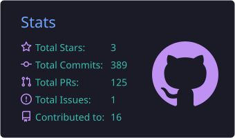
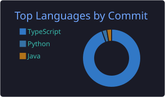
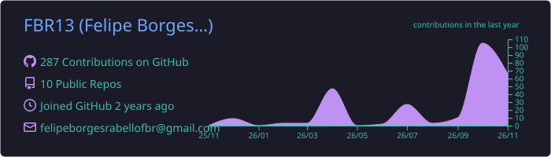

<!-- Header -->
<p align="center">
  
</p>

<p align="center">
  <a href="https://git.io/typing-svg"></a>
</p>

<p align="center">
  <a href="https://www.linkedin.com/in/fbr1313/"></a>
  <a href="mailto:felipeborgesrabellofbr@gmail.com"></a>
  <a href="https://44go-platform2.vercel.app/"></a>
  
</p>

---

## • Sobre mim

```ts
const felipe = {
  role: "Estudante de Ciência da Computação",
  education: "PUC Goiás — 8º período",
  location: "Goiânia, GO — Brasil 🇧🇷",
  frontend: ["React", "Next.js", "Tailwind CSS", "Framer Motion"],
  backend: ["NestJS", "Node.js", "Express", "REST APIs", "JWT Auth"],
  database: ["Supabase", "PostgreSQL"],
  payments: ["Stripe"],
  deploy: ["Vercel", "Git/GitHub"],
  openTo: ["Estágio", "Freelance", "Projetos open source"],
};
```

-  Estudante de **Ciência da Computação** na **PUC Goiás** — atualmente no **8º período**
-  Aprendendo desenvolvimento web com **TypeScript**, praticando front-end e back-end em projetos próprios
-  Projeto mais completo até agora: um **marketplace com checkout Stripe**, painel do lojista e área do entregador
-  Os projetos em destaque estão **publicados** na Vercel

---

## • Stack

<p align="center">
  <br/>
  <br/>
  
</p>

<p align="center">
  
  
  
  
  
</p>

---

## • Projetos em destaque

<table>
  <tr>
    <td width="50%" valign="top">
      <h3>🛒 <a href="https://github.com/FBR13/44go-platform2">44Go — Marketplace Local</a></h3>
      <p>Plataforma de delivery local com lojas, produtos, carrinho, <b>checkout com Stripe</b>, painel do lojista e área do entregador. API modular com autenticação JWT.</p>
      <p>
        
        
        
        
      </p>
      <a href="https://44go-platform2.vercel.app"><b>🔗 Ver demo</b></a> · <a href="https://github.com/FBR13/44go-platform2"><b>📂 Código</b></a>
    </td>
    <td width="50%" valign="top">
      <h3>🏎️ <a href="https://github.com/FBR13/BlogTorqueGyn">TorqueGyn</a></h3>
      <p>Blog editorial automotivo com <b>editor de texto rico</b>, painel administrativo com gráficos e SEO otimizado.</p>
      <p>
        
        
        
        
      </p>
      <a href="https://blog-torque-gyn.vercel.app"><b>🔗 Ver demo</b></a> · <a href="https://github.com/FBR13/BlogTorqueGyn"><b>📂 Código</b></a>
    </td>
  </tr>
  <tr>
    <td width="50%" valign="top">
      <h3>⚡ <a href="https://github.com/FBR13/velox-web">Velox System</a></h3>
      <p>Landing page institucional moderna com <b>animações fluidas</b>, design responsivo e consentimento de cookies (LGPD).</p>
      <p>
        
        
        
        
      </p>
      <a href="https://velox-web-two.vercel.app"><b>🔗 Ver demo</b></a> · <a href="https://github.com/FBR13/velox-web"><b>📂 Código</b></a>
    </td>
    <td width="50%" valign="top">
      <h3>🎓 <a href="https://github.com/FBR13/College-Activity">Atividades Acadêmicas</a></h3>
      <p>Exercícios e trabalhos da graduação em Ciência da Computação: <b>algoritmos, estruturas de dados e POO</b>.</p>
      <p>
        
        
        
      </p>
      <a href="https://github.com/FBR13/College-Activity"><b>📂 Código</b></a>
    </td>
  </tr>
</table>

---

## • GitHub Stats

<p align="center">
  
  
</p>
<p align="center">
  
</p>
<p align="center">
  
</p>

<p align="center">
  <picture>
    <source media="(prefers-color-scheme: dark)" srcset="https://raw.githubusercontent.com/FBR13/FBR13/output/snake-dark.svg"/>
    
  </picture>
</p>

---

<p align="center"><i>Sempre aprendendo, sempre construindo. Aberto a oportunidades de estágio e colaboração!</i></p>

<p align="center">
  
</p>
